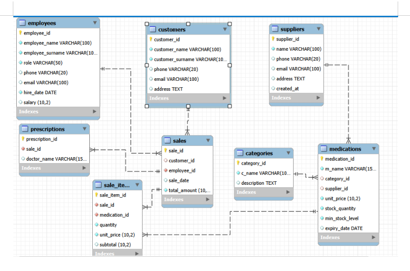

# 🏥 Pharmacy Management Database System (MySQL)

A relational database management system designed to streamline pharmacy operations, including inventory tracking, supplier management, prescription linking, sales processing, and automated stock control.

## 📐 Database Architecture (ER Diagram)
The database is normalized to **3NF (Third Normal Form)** and consists of 8 interconnected tables enforcing referential integrity via Primary and Foreign Keys.



### Core Tables
* **`suppliers` & `categories`**: Vendor contact details and medication classifications.
* **`medications`**: Product catalog with pricing, stock levels, minimum reorder thresholds, and expiration dates.
* **`customers` & `employees`**: Customer profiles and pharmacy staff records (pharmacists, cashiers, managers, warehouse staff).
* **`sales` & `sale_items`**: Transactional headers and itemized line items utilizing MySQL `GENERATED ALWAYS AS` computed columns for subtotals.
* **`prescriptions`**: Links prescription-only sales to issuing doctors.

## ⚡ Key Technical Features
* **Automated Inventory Sync (Trigger):** `trg_reduce_stock` automatically deducts sold quantities from `medications.stock_quantity` in real time upon every new entry in `sale_items`.
* **Custom Business Logic (Stored Functions):**
  * `get_customer_total(customer_id)`: Calculates total historical spend per customer.
  * `check_stock_status(medication_id)`: Evaluates current inventory against `min_stock_level` (`Low Stock` vs. `Sufficient`).
* **Reporting Layer (View):** `SaleDetails` consolidates customer, transaction, and product data into a single queryable interface.

## 🚀 How to Run
1. Clone the repository:
   ```bash
   git clone [https://github.com/elinagiyevmurad-stack/pharmacy-management-sql.git](https://github.com/elinagiyevmurad-stack/pharmacy-management-sql.git)